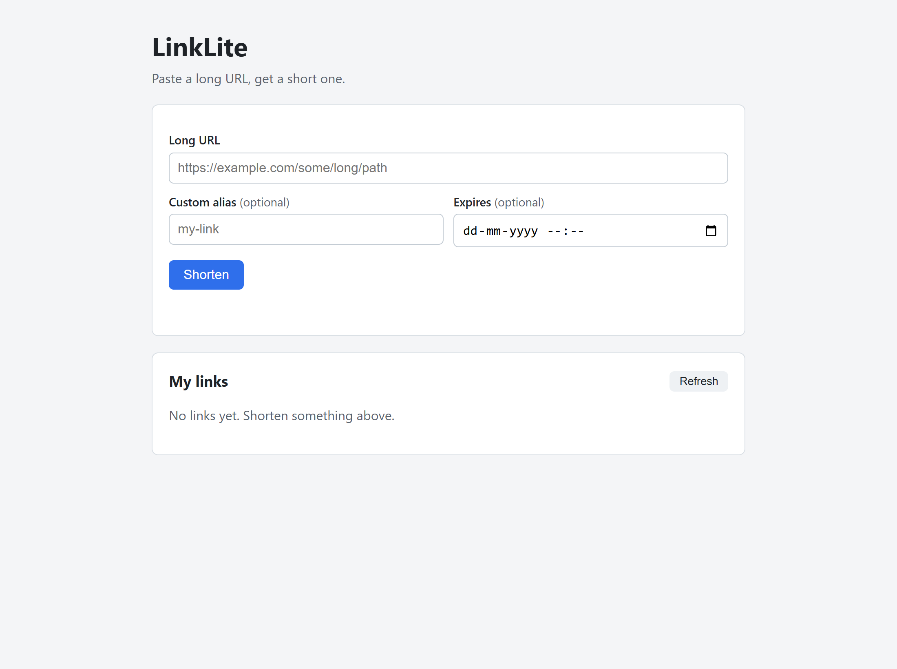
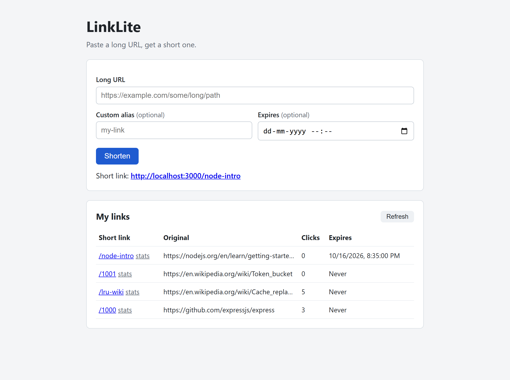
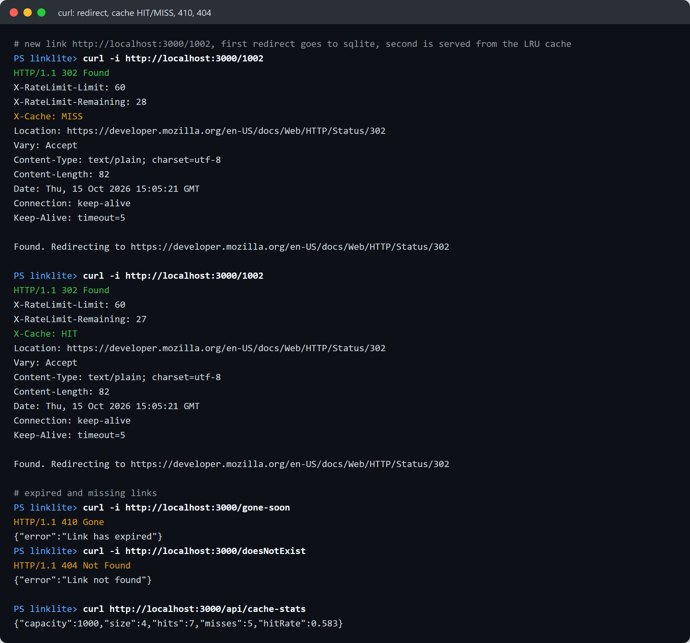
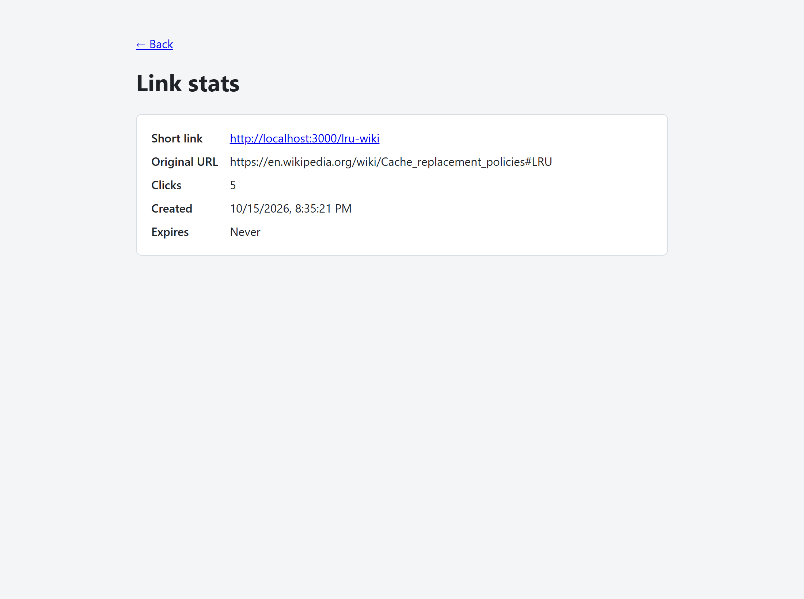
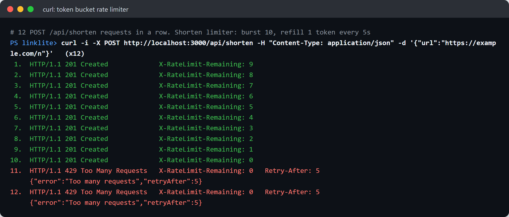
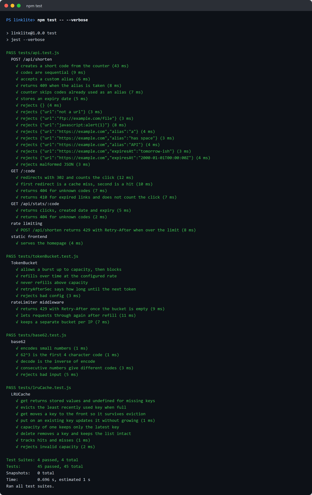
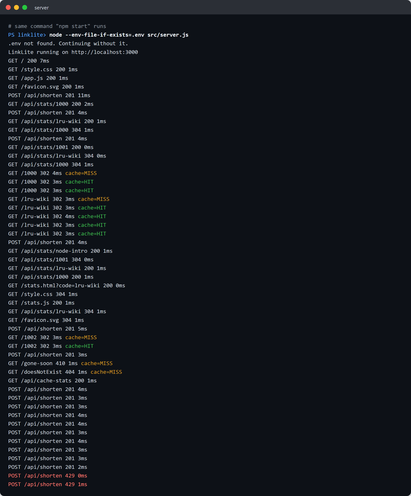
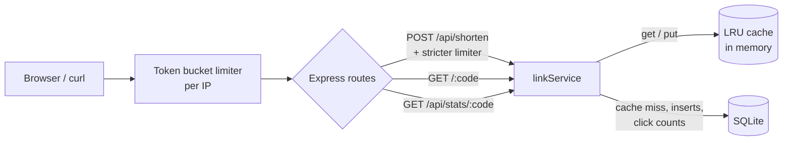

# LinkLite

[](https://github.com/Saipavanavsp/linklite/actions/workflows/test.yml)

A small URL shortener built with Node.js, Express and SQLite. The two parts I
cared most about are written by hand instead of pulled from npm:

- an **LRU cache** (hash map + doubly linked list) that sits in front of the
  database for redirects
- a **token bucket rate limiter**, per IP, as Express middleware

Short codes come from an auto-increment counter encoded in base62, not random
strings.

## Features

- `POST /api/shorten` with optional custom alias and optional expiry date
- `GET /:code` does a 302 redirect and counts the click (404 if missing, 410 if expired)
- `GET /api/stats/:code` shows clicks, created date and expiry
- `GET /api/cache-stats` shows cache hits/misses, and every redirect has an
  `X-Cache: HIT|MISS` header
- 429 with `Retry-After` when a client goes over the limit
- Plain HTML/CSS/JS frontend: shorten a link, see your links and their click counts
- 45 Jest tests (unit tests + API tests with supertest)

## Demo

All screenshots come from one real local run of the app (`npm start` on
port 3000 with the default settings). Every test also runs on GitHub Actions
on each push; see the badge above.

### Homepage



### Shortening links

Four links: two counter codes (`1000`, `1001`), a custom alias (`lru-wiki`),
and one with an expiry date (`node-intro`). The click counts come from real
redirects.



### Redirect, cache HIT/MISS, 410 and 404

The first redirect for a new code reads SQLite (`X-Cache: MISS`). The second
is served from the LRU cache (`X-Cache: HIT`). An expired link returns 410
and an unknown code returns 404.



### Stats page



### Rate limiter (429)

12 POSTs in a row to `/api/shorten`. The bucket holds 10 tokens, so
requests 11 and 12 get `429` with `Retry-After`.



### Tests



### Server log

Every request from the run above, with cache hits and misses on redirects.



## Architecture



```
src/
  app.js                  builds the express app (used by server.js and the tests)
  server.js               reads env vars and starts listening
  db.js                   opens sqlite and creates tables
  routes/api.js           /api/shorten, /api/stats/:code, /api/cache-stats
  routes/redirect.js      /:code
  services/linkService.js all db queries + the cache lookup
  middleware/rateLimiter.js
  utils/base62.js
  utils/lruCache.js
  utils/tokenBucket.js
public/                   frontend (index.html, stats.html)
tests/                    jest tests
docs/                     api examples and screenshots
```

## How the LRU cache works

`src/utils/lruCache.js`

- A `Map` from key to a list node gives O(1) lookup.
- A doubly linked list keeps the order of use. The most recently used node is
  right after `head`, the least recently used is right before `tail`.
- `head` and `tail` are dummy nodes, so inserting and removing never needs
  null checks.
- `get(key)`: look up the node, unlink it, put it at the front. O(1).
- `put(key, value)`: if the key exists, update and move to front. Otherwise,
  if the cache is full, remove `tail.prev` (the LRU entry) from both the list
  and the map, then add the new node at the front. O(1).

The cache stores `{ url, expiresAt }` for each code. Links never change after
they are created, so nothing needs to be invalidated. Expiry is checked on
every redirect, so a cached link still returns 410 once it expires.

Cache misses are not cached. If they were, a code that did not exist yet
would keep returning 404 after someone created it.

(A JS `Map` remembers insertion order, so you could build an LRU with just a
`Map` by deleting and re-inserting keys. I used the linked list on purpose
because that's the classic design and it works the same way in any language.)

## How the token bucket works

`src/utils/tokenBucket.js`, `src/middleware/rateLimiter.js`

- Each IP gets a bucket with `capacity` tokens. Every request takes one token.
- Tokens refill at `refillPerSec`, up to `capacity`.
- Refill is lazy: there's no timer per bucket. When a request comes in, the
  bucket adds `elapsedSeconds * refillPerSec` tokens and then tries to take one.
- No token left: respond `429` with `Retry-After` set to
  `ceil((1 - tokens) / refillPerSec)` seconds.
- A cleanup interval (unref'd so it doesn't keep the process alive) deletes
  buckets that have refilled to full, since a full bucket is the same as a new
  one. This keeps memory from growing with every IP ever seen.

There are two limiters:

| Limiter | Applies to | Default |
|---|---|---|
| general | every request | burst 60, refill 1/sec |
| shorten | `POST /api/shorten` | burst 10, refill 1 every 5 sec |

The token bucket allows short bursts but caps the average rate. A fixed
window counter is simpler, but it lets a client send twice the limit around
the window boundary.

## API

| Method | Path | Body | Success | Errors |
|---|---|---|---|---|
| POST | `/api/shorten` | `{ "url", "alias"?, "expiresAt"? }` | `201` link JSON | `400` invalid input, `409` alias taken, `429` |
| GET | `/:code` | | `302` redirect, `X-Cache` header | `404` missing, `410` expired, `429` |
| GET | `/api/stats/:code` | | `200` `{ code, url, shortUrl, clicks, custom, createdAt, expiresAt, expired }` | `404` |
| GET | `/api/cache-stats` | | `200` `{ capacity, size, hits, misses, hitRate }` | |

Rules:

- `url` must be `http` or `https`, max 2048 characters.
- `alias` is 3-30 characters from `A-Z a-z 0-9 - _`. `api`, `index` and
  `stats` are reserved.
- `expiresAt` is any date string `Date.parse` understands, and it must be in
  the future. It's stored as UTC ISO.

Full request/response examples are in [docs/api.md](docs/api.md).

## Setup

Requires Node.js 22 or newer (it uses `node --env-file-if-exists`).

```bash
git clone https://github.com/Saipavanavsp/linklite.git
cd linklite
npm install
cp .env.example .env      # optional, every value has a default
npm start
```

Open http://localhost:3000.

The SQLite file is created at `data/linklite.db` (gitignored). `better-sqlite3`
ships prebuilt binaries for Windows, macOS and Linux, so you don't need a C++
compiler. Its compile-from-source script is turned off in `allowScripts` in
`package.json`.

### Configuration

| Variable | Default | Meaning |
|---|---|---|
| `PORT` | `3000` | |
| `BASE_URL` | `http://localhost:PORT` | used to build `shortUrl` |
| `DB_PATH` | `./data/linklite.db` | |
| `CACHE_SIZE` | `1000` | max links in the LRU cache |
| `RATE_LIMIT_CAPACITY` / `RATE_LIMIT_REFILL` | `60` / `1` | general limiter |
| `SHORTEN_LIMIT_CAPACITY` / `SHORTEN_LIMIT_REFILL` | `10` / `0.2` | shorten limiter |
| `TRUST_PROXY` | `0` | set to `1` behind a reverse proxy so the real client IP is used |

## Running tests

```bash
npm test
```

```
Test Suites: 4 passed, 4 total
Tests:       45 passed, 45 total
```

- `tests/base62.test.js`: known values, round trips, invalid input
- `tests/lruCache.test.js`: eviction order, `get` refreshing a key, updates, hit/miss counts
- `tests/tokenBucket.test.js`: burst, refill, capacity cap, `Retry-After` math, per-IP buckets
  (uses a fake clock, so no sleeps)
- `tests/api.test.js`: every endpoint against an in-memory SQLite database, including
  404, 410, 409, 400 cases, cache HIT/MISS and the 429

## Design trade-offs

**Why a base62 counter instead of random strings**

- No collisions and no retry loop. Every code is unique by construction.
- Codes stay as short as possible: 62^4 is about 14.7 million codes in 4
  characters, and 62^6 is about 56 billion in 6.
- The counter starts at 62^3, so generated codes are at least 4 characters long.
- Custom aliases share the same namespace (`abcd` is also a base62 number), so
  if the counter lands on a code that's already taken as an alias, it skips it.
- Downside: codes are guessable and show how many links exist. If that matters,
  you can shuffle the counter with a bijective function (multiply by a large
  odd number mod 62^n, or Feistel rounds). You keep uniqueness and the codes
  stop looking sequential.

**Why LRU for the cache**

- Redirect traffic is very skewed: a few links get most of the clicks. LRU
  keeps the popular ones in memory without extra bookkeeping.
- LFU could do better for traffic that stays hot for a long time, but it's
  more complex and slow to adapt when a link suddenly goes viral.

**Limits of this design**

- Click counting is a SQLite `UPDATE` on every redirect, so the cache only
  saves the read. For heavy traffic, counts should be buffered in memory and
  written in batches, or sent to a queue.
- The cache and the rate limiter live inside one process. Running two
  instances would give each its own cache and its own bucket per IP.
- SQLite allows only one writer at a time. That's fine for a single server,
  but it's not a database for many write-heavy app servers.
- "My links" in the UI is just a list of codes in `localStorage`. There are no
  user accounts.
- No check for malicious target URLs.

**How it would scale**

1. Move the database to Postgres (or a key-value store like DynamoDB/Cassandra,
   since the main access pattern is lookup by code).
2. Put Redis in front of it as a shared cache, and keep a small in-process LRU
   as an L1 cache.
3. Move the token buckets into Redis (a Lua script for an atomic
   refill-and-take) so every instance enforces the same limit.
4. Hand out ID ranges per instance (each one reserves, say, 1000 IDs at a
   time) so the counter isn't a single point of contention.
5. Send click events to a queue (Kafka/SQS) and aggregate them separately.
6. Use a CDN or edge cache for the hottest redirects.

## Author

Sai Pavan

## License

MIT, see [LICENSE](LICENSE).
