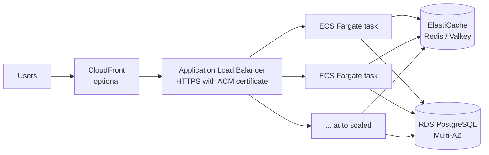

# Deploying LinkLite on AWS

Part 1 runs the whole Docker Compose setup (nginx, 2 app instances,
Postgres, Redis) on one small EC2 instance, with HTTPS from Caddy and Let's
Encrypt. Part 2 is how the same pieces map to managed AWS services when one
machine isn't enough.

Nothing here needs AWS access keys on the server. You use the AWS console
from your browser and SSH into the instance.

## Part 1: one EC2 instance with Docker Compose

### What you need

- An AWS account.
- A domain (or subdomain) where you can add a DNS record. Let's Encrypt needs
  a real hostname. It won't issue a certificate for a bare IP.
- An SSH client (built into macOS, Linux and Windows 10+).

### 1. Launch the instance

In the EC2 console, **Launch instance**:

| setting | value |
|---|---|
| Name | `linklite` |
| AMI | Ubuntu Server 24.04 LTS (64-bit x86) |
| Instance type | `t3.micro` or `t2.micro`, whichever your account shows as free tier eligible |
| Key pair | create one, download the `.pem` file and keep it private |
| Storage | 20 GB gp3 (free tier covers up to 30 GB) |

Free tier rules change from time to time and depend on when the account was
created, so check the **Free tier eligible** label in the console, and set
up a billing alarm (Billing > Budgets > create a $1 budget) before you start.

### 2. Security group

Create a security group with these inbound rules:

| type | port | source | why |
|---|---|---|---|
| SSH | 22 | My IP | only you can log in |
| HTTP | 80 | 0.0.0.0/0 and ::/0 | Let's Encrypt check + redirect to HTTPS |
| HTTPS | 443 | 0.0.0.0/0 and ::/0 | the site |
| Custom UDP | 443 | 0.0.0.0/0 and ::/0 | HTTP/3 (optional) |

Don't open 5432 (Postgres), 6379 (Redis) or 8080 (nginx). In the Caddy
setup they're only reachable inside the Docker network.

### 3. Static IP and DNS

1. EC2 > **Elastic IPs** > Allocate, then **Associate** it with the
   instance. Without this, the public IP changes every time the instance is
   stopped. An Elastic IP is free while it's attached to a running instance.
2. At your DNS provider, add an **A record** for your hostname (for example
   `links.example.com`) pointing to the Elastic IP.
3. Wait until `nslookup links.example.com` returns that IP.

### 4. Connect and install Docker

```bash
chmod 400 linklite.pem
ssh -i linklite.pem ubuntu@<elastic-ip>
```

On the instance:

```bash
sudo apt-get update && sudo apt-get upgrade -y

# Docker Engine + Compose plugin from Docker's own apt repo
sudo apt-get install -y ca-certificates curl
sudo install -m 0755 -d /etc/apt/keyrings
sudo curl -fsSL https://download.docker.com/linux/ubuntu/gpg -o /etc/apt/keyrings/docker.asc
echo "deb [arch=$(dpkg --print-architecture) signed-by=/etc/apt/keyrings/docker.asc] \
  https://download.docker.com/linux/ubuntu $(. /etc/os-release && echo $VERSION_CODENAME) stable" \
  | sudo tee /etc/apt/sources.list.d/docker.list > /dev/null
sudo apt-get update
sudo apt-get install -y docker-ce docker-ce-cli containerd.io docker-buildx-plugin docker-compose-plugin

# run docker without sudo (log out and back in afterwards)
sudo usermod -aG docker ubuntu
exit
```

SSH in again and check: `docker compose version`.

**Add swap.** A micro instance has 1 GB of RAM, and Postgres, Redis, nginx,
Caddy and two Node processes together come close to that. Building the image
needs a bit more. 2 GB of swap avoids out-of-memory kills:

```bash
sudo fallocate -l 2G /swapfile
sudo chmod 600 /swapfile
sudo mkswap /swapfile
sudo swapon /swapfile
echo '/swapfile none swap sw 0 0' | sudo tee -a /etc/fstab
```

### 5. Get the code and configure it

```bash
git clone https://github.com/Saipavanavsp/linklite.git
cd linklite
cp .env.example .env
nano .env
```

Set at least these in `.env`. Docker Compose reads this file for the
`${...}` values in the compose files.

```bash
DOMAIN=links.example.com
ACME_EMAIL=you@example.com           # Let's Encrypt sends expiry warnings here
BASE_URL=https://links.example.com
POSTGRES_PASSWORD=<generate one>     # e.g. the output of: openssl rand -hex 24
```

Generate the password on the server and paste it in. Don't reuse the
default. Keep `.env` out of git (it's already in `.gitignore`) and readable
only by you: `chmod 600 .env`.

Everything else (rate limits, cache sizes) can stay at the defaults.

### 6. Start it with HTTPS

```bash
docker compose -f docker-compose.yml -f docker-compose.caddy.yml up -d --build
docker compose -f docker-compose.yml -f docker-compose.caddy.yml ps
```

`docker-compose.caddy.yml` adds a Caddy container on ports 80 and 443 and
stops publishing nginx on the host. Traffic goes:

```
internet -> Caddy :443 (TLS) -> nginx :80 -> app1 / app2 -> Postgres, Redis
```

On first start Caddy asks Let's Encrypt for a certificate. That only works
once DNS points at the instance and port 80 is open. Watch it happen:

```bash
docker compose -f docker-compose.yml -f docker-compose.caddy.yml logs -f caddy
```

Then open `https://links.example.com`. Caddy renews the certificate on its
own. Certificates are kept in the `caddy_data` volume, so restarts don't hit
Let's Encrypt's rate limits.

**Client IPs.** Caddy sets `X-Forwarded-For` to the real client address.
nginx trusts that header only from the Docker network (`set_real_ip_from` in
`nginx/nginx.conf`) and passes it on, and the app trusts one proxy hop
(`TRUST_PROXY=1`). So the rate limiter sees real client IPs, and clients
can't fake them.

To save typing, put this in `~/.bashrc`:

```bash
alias dc='docker compose -f docker-compose.yml -f docker-compose.caddy.yml'
```

#### Alternative: nginx + Certbot instead of Caddy

If you'd rather not add Caddy, you can install nginx and Certbot on the host
(`sudo apt-get install nginx certbot python3-certbot-nginx`). Then:

1. Set `HTTP_PORT=127.0.0.1:8080` in `.env` and start Compose without the
   Caddy file, so the Compose nginx is only reachable from the host itself.
2. In the host nginx, proxy `server_name links.example.com` to
   `http://127.0.0.1:8080` with
   `proxy_set_header X-Forwarded-For $remote_addr;`. Otherwise every client
   shows up with the same IP and they all share one rate limit bucket.
3. Run `sudo certbot --nginx -d links.example.com`. Certbot sets up renewal with
a systemd timer. Caddy is less to maintain, which is why it's the default
here.

### 7. Check it

```bash
curl -s https://links.example.com/healthz
# {"status":"ok","db":"up","redis":"up"}

curl -s -X POST https://links.example.com/api/shorten \
  -H "Content-Type: application/json" -d '{"url":"https://example.com"}'

curl -sI https://links.example.com/1000 | grep -i -E "location|x-instance|x-cache"
```

`/metrics` is blocked from the internet by nginx. Read it from the server:

```bash
dc exec nginx wget -qO- http://127.0.0.1/metrics
```

### 8. Day-to-day

**Deploy a new version**

```bash
cd ~/linklite
git pull
dc up -d --build
```

Compose recreates the app containers, and each one drains its requests on
SIGTERM before it stops. With a single machine there's still a short moment
when both apps restart. For true zero downtime, restart one at a time:
`dc up -d --no-deps --build app1`, wait until it's healthy, then `app2`.

**Logs**: `dc logs -f app1 app2` (add `--since 10m` to limit them).

**Backups.** The data is in the `pgdata` volume, on the instance's disk.
A nightly dump is a reasonable minimum:

```bash
mkdir -p ~/backups
crontab -e
# add:
0 3 * * * cd ~/linklite && docker compose exec -T postgres pg_dump -U linklite linklite | gzip > ~/backups/linklite-$(date +\%F).sql.gz && find ~/backups -mtime +7 -delete
```

Copy them somewhere off the instance too (S3, or `scp` to your laptop).
EBS snapshots of the volume are another option (EC2 > Volumes > Create
snapshot).

**Restore**: `gunzip -c backup.sql.gz | dc exec -T postgres psql -U linklite linklite`

**Updates**: `sudo apt-get update && sudo apt-get upgrade -y` now and then,
and `dc pull && dc up -d` for newer Postgres/Redis/nginx/Caddy patch versions.

### 9. Tearing it down

To stop paying for anything: terminate the instance, then **release** the
Elastic IP (an unattached Elastic IP is billed), and delete any snapshots.

### What this setup doesn't give you

Everything is on one machine, so this is about isolation and practice, not
high availability. If the instance dies, the site is down, and the data is
only as safe as your last backup. Two app containers on one host still help:
a crash or a deploy of one doesn't take the site down, and it's the same
layout you'd scale out from.

## Part 2: mapping to managed AWS services

The app doesn't need code changes to move to managed services. Everything it
depends on comes in through environment variables (`DATABASE_URL`,
`REDIS_URL`, `TRUST_PROXY`, ...).



| in Compose | on AWS | notes |
|---|---|---|
| `nginx` | **Application Load Balancer** | Health check path `/healthz`. ALB appends the client IP to `X-Forwarded-For`, and `TRUST_PROXY=1` makes the app read it. TLS with a free ACM certificate replaces Caddy. |
| `app1`, `app2` | **ECS on Fargate**, one service, 2+ tasks across 2 AZs | Push the same image to **ECR**. Auto scale on CPU or on ALB request count per target. Set the target group's deregistration delay a bit above `SHUTDOWN_TIMEOUT_MS`, so the ALB stops sending traffic before the task exits. |
| `postgres` | **RDS for PostgreSQL** (Multi-AZ for failover) | `DATABASE_URL=postgres://...@<rds-endpoint>:5432/linklite`. Run migrations as a one-off ECS task (`node scripts/migrate.js`) before each deploy. They take an advisory lock, so a double run is harmless. Set `PG_POOL_MAX` so that tasks × pool size stays under the instance's `max_connections`, or put RDS Proxy in between. |
| `redis` | **ElastiCache** (Redis OSS or Valkey) | Use a single shard (cluster mode disabled) with a replica. The app uses plain keys, pub/sub and one-key Lua scripts, which all work there. With in-transit encryption on, the URL starts with `rediss://`. |
| `migrate` | ECS one-off task, or a step in the CI/CD pipeline | |
| `.env` file | **Secrets Manager** / SSM Parameter Store | Referenced from the ECS task definition, so passwords never sit in files or images. |
| `docker compose logs` | **CloudWatch Logs** (`awslogs` driver) | |
| `/metrics` JSON | CloudWatch / Amazon Managed Prometheus | The JSON endpoint would become a Prometheus endpoint, scraped from every task. |
| Caddy + Let's Encrypt | **ACM** certificate on the ALB | |

Networking: ALB in public subnets, tasks, RDS and ElastiCache in private
subnets. Security groups chain: the ALB allows 443 from anywhere, tasks
allow 3000 only from the ALB, RDS allows 5432 only from tasks, and
ElastiCache allows 6379 only from tasks.

Things that change at that scale:

- **Rate limiting.** Redis stays the shared store. AWS WAF rate-based rules
  in front of the ALB are a good first line for floods, and the app's
  limiter handles the finer per-route limits.
- **Hot redirects.** CloudFront can cache `302` responses for a few seconds
  to soak up spikes on a viral link, at the cost of not counting those clicks.
- **Click counts.** At high volume, `UPDATE ... clicks + 1` per redirect
  becomes the bottleneck. Buffer counts in Redis and flush them in batches,
  or send click events to SQS/Kinesis.
- **ID blocks.** Raise `ID_BLOCK_SIZE` as the number of tasks grows, so the
  counter row is touched rarely.
- **Cost.** This setup is far from free tier: RDS Multi-AZ, ElastiCache,
  the ALB and Fargate tasks each bill hourly. Part 1 is the cheap way to run
  a demo. Part 2 is what you'd move to when traffic needs it.
